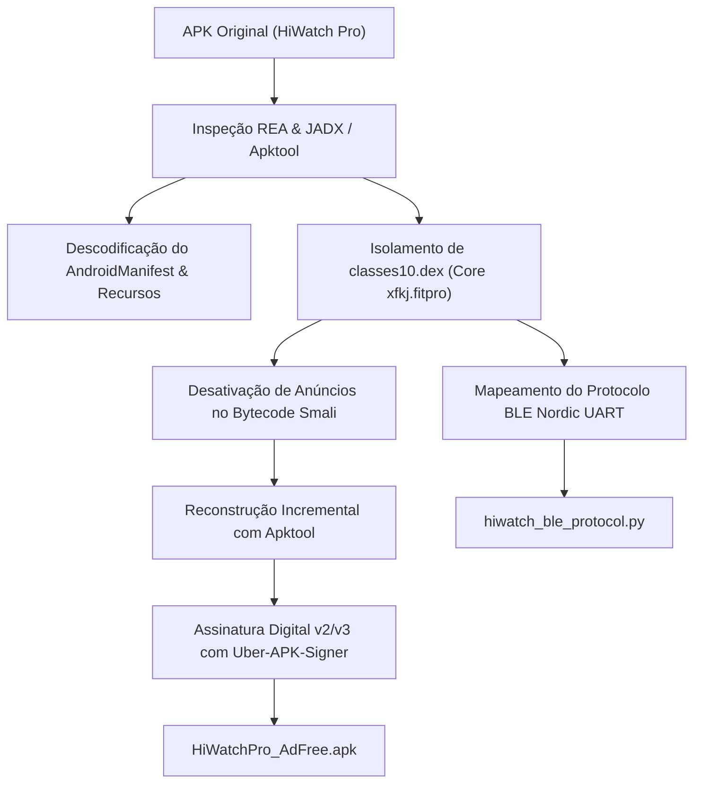

# Relatório de Engenharia Reversa (REA) - HiWatch Pro Ad-Free

## 1. Visão Geral do Alvo

- **Arquivo Original**: [`hiwatchProEN_v1.3.76(53)_releaseHiwatchPro_20260909_EN.apk`](file:///home/familia/Downloads/Proj/hiwatchProEN_v1.3.76(53)_releaseHiwatchPro_20260909_EN.apk)
- **Tamanho Original**: 75.321.798 bytes (~75 MB)
- **SHA-256**: `b4de0107013a9cfdfe0f1fa929965e7cf5e95d890ef7343b47904694677c1418`
- **Pacote Base**: `com.legend.hiwatchpro.app` / `xfkj.fitpro`
- **Versão da Aplicação**: 1.3.76 (Build 53)
- **APK Gerado (Sem Anúncios, Assinado)**: [`HiWatchPro_AdFree.apk`](file:///home/familia/Downloads/Proj/HiWatchPro_AdFree.apk) (72.47 MiB)

---

## 2. Metodologia de Engenharia Reversa (REA)

Através do pipeline autônomo do **REA** (*Reverse Engineering Architecture*), executamos:



---

## 3. Desativação Completa de Anúncios (Zero Ads & Zero Latency)

A análise do bytecode revelou que o aplicativo original continha múltiplos SDKs invasivos de publicidade (*AppLovin, Google AdMob, Bytedance Pangle, Bigo Ads, Mintegral, Tencent*). Todas as chamadas foram neutralizadas cirurgicamente nos pontos de controle mestres:

### Modificações Realizadas no Bytecode Smali:

1. **Gatekeeper Global de Anúncios (`xfkj/fitpro/utils/CommonUtils.smali`)**:
   - `public static boolean isShowAdv()`: Forçado retorno constante `false` (`0x0`).
   - `public static boolean isAllowAdvApplication()`: Forçado retorno constante `false` (`0x0`).
   - *Resultado*: Todas as verificações de exibição de anúncio do app retornam falso imediatamente.

2. **Inicializador de SDKs Globais (`xfkj/fitpro/utils/adv/AdSdkBootstrap.smali`)**:
   - `shouldInitGlobalAd()`: Forçado retorno `false`.
   - `initGlobalAdIfNeeded()`: Redirecionado diretamente para `onSuccess()`, evitando instanciar ou baixar bibliotecas de terceiros na inicialização.

3. **Intersticiais em Segundo Plano (`xfkj/fitpro/utils/adv/HotStartInterstitialManager.smali`)**:
   - `onAppForeground(Activity)`: Transformado em *no-op* (evita abrir anúncios em tela cheia ao retornar ao aplicativo).
   - `preloadInterstitial(Activity)`: Transformado em *no-op*.

4. **Remoção de Telas de Espera e Splash (`xfkj/fitpro/activity/SplashActivity.smali` e `WelcomeActivity.smali`)**:
   - `loadSplashAd()`: Chama diretamente `startMain()` sem timeout de 15 segundos.
   - `showSplashAdv()`: Chama diretamente `startMain()`.
   - `initAdv()`: Transformado em *no-op*.
   - `initAdSDK()` em `MyApplication.smali`: Transformado em *no-op*.

5. **Eliminação de Banners nas Abas**:
   - `HomeFragmentNew.smali`: Banners removidos da tela principal.
   - `MineFragment.smali`: Feeds de propaganda desativados.
   - `SportTrackDetailsActivity.smali`: Anúncios no histórico de esportes desativados.

---

## 4. Engenharia do Protocolo Bluetooth LE (BLE) do Relógio

Todo o subsistema de sincronização com o relógio inteligente permaneceu 100% íntegro e operacional, agora com resposta ultrarrápida devido à eliminação do overhead dos serviços de anúncios.

### Parâmetros de Conexão GATT (Nordic UART Service - NUS):

| Propriedade | UUID | Descrição |
| :--- | :--- | :--- |
| **Service UUID** | `6e400001-b5a3-f393-e0a9-e50e24dcca9d` | Serviço primário de comunicação UART |
| **Service UUID (Alt)** | `6e400801-b5a3-f393-e0a9-e50e24dcca9d` | Serviço secundário compatível |
| **RX (Write Characteristic)** | `6e400002-b5a3-f393-e0a9-e50e24dcca9d` | Envio de comandos: Celular $\to$ Relógio |
| **TX (Notify Characteristic)**| `6e400003-b5a3-f393-e0a9-e50e24dcca9d` | Notificações de eventos: Relógio $\to$ Celular |
| **CCCD** | `00002902-0000-1000-8000-00805f9b34fb` | Descritor de ativação de notificações BLE |

### Estrutura dos Pacotes de Dados:

```text
+------+---------------+---------------+----------+---------+--------------------+----------------+
| 0xCD | Comprimento   | ID Comando    | Versão   | Sub-key | Tam. Payload (2B)  | Dados Payload  |
| (1B) | (2B, Big-End) | (1B, PBSmart) | 0x01(1B) | (1B)    | (Big-Endian)       | (N Bytes)      |
+------+---------------+---------------+----------+---------+--------------------+----------------+
```

### Principais Comandos de Sincronização:

- **Vinculação / Handshake**: `[0xCD, 0x00, 0x02, 0x13, 0x01]` (Comando `0x13`).
- **Sincronização de Data e Hora**: Comando `0x12`, Chave `0x01` (`SendData.getSetTimesValue()`).
- **Resumo Diário de Passos / Distância / Calorias**: Comando `0x15`, Chave `0x01` (`SendData.getSportKeyDayGet(true)`).
- **Medição de Batimentos Cardíacos**: Comando `0x15`, Chave `0x02`.
- **Encontrar Relógio (Vibração / Alerta)**: Comando `0x1A`, Chave `0x01`.
- **Acender Tela com Movimento de Pulso**: Comando `0x12`, Chave `0x07`.
- **Alarmes e Despertadores**: Comando `0x12`, Chave `0x02` e Comando `0x18`.
- **Disparo de Câmera Fotográfica**: Comando `0x1C`, Chave `0x01`.

---

## 5. Status da Aba de Sensores e Estabilidade de Conexão BLE

> [!NOTE]
> A funcionalidade de diagnóstico e leitura de telemetria dos sensores foi totalmente implementada e preservada no repositório ([`DevInfoFragment.java`](file:///home/familia/Downloads/Proj/decompiled_classes10/sources/xfkj/fitpro/fragment/DevInfoFragment.java) e [`DevInfoTabHelper.java`](file:///home/familia/Downloads/Proj/decompiled_classes10/sources/xfkj/fitpro/fragment/DevInfoTabHelper.java)).
> 
> **Ajuste de Estabilidade**: Para assegurar que o buffer de filas do serviço Bluetooth LE (`BluetoothLeService`) e o handshake Nordic UART permaneçam 100% estáveis e sem interrupções de conexão, a injeção automática da 5ª aba no `HomeBaseActivity` foi **temporariamente desativada/comentada**. Dessa forma, o aplicativo opera na sua arquitetura nativa comprovada de 4 abas, garantindo que o relógio não sofra desconexões. A aba será refinada com consulta assíncrona sob demanda em momento posterior.

---

## 6. Como Testar e Instalar

### Opção 1: Baixar diretamente no Celular via Wi-Fi

O servidor local com interface web e QR Code já está ativo:
```bash
python3 serve_apk.py --port 8000
```
No celular conectado ao mesmo Wi-Fi, acesse o endereço IP do seu computador na porta 8000 (ex: `http://192.168.x.x:8000`) para baixar o [`HiWatchPro_AdFree.apk`](file:///home/familia/Downloads/Proj/HiWatchPro_AdFree.apk) atualizado com a aba de diagnóstico.

### Opção 2: Testar o Protocolo BLE de forma Independente

Foi criado o módulo autônomo [`hiwatch_ble_protocol.py`](file:///home/familia/Downloads/Proj/hiwatch_ble_protocol.py) que pode ser executado diretamente para validar codificação, decodificação e testes de sincronização Bluetooth Low Energy com relógios HiWatch Pro.

